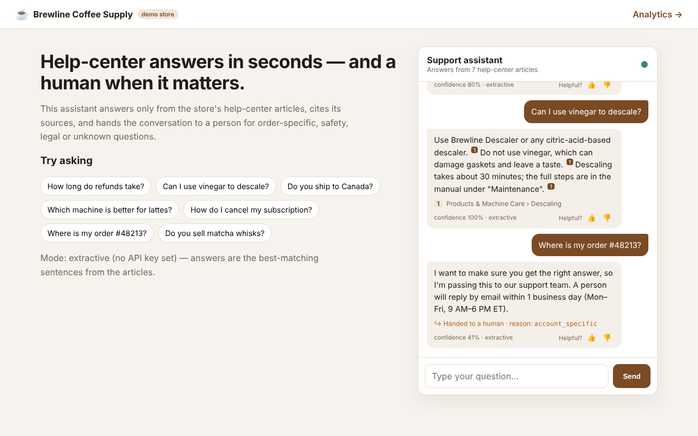
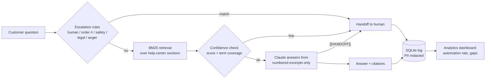
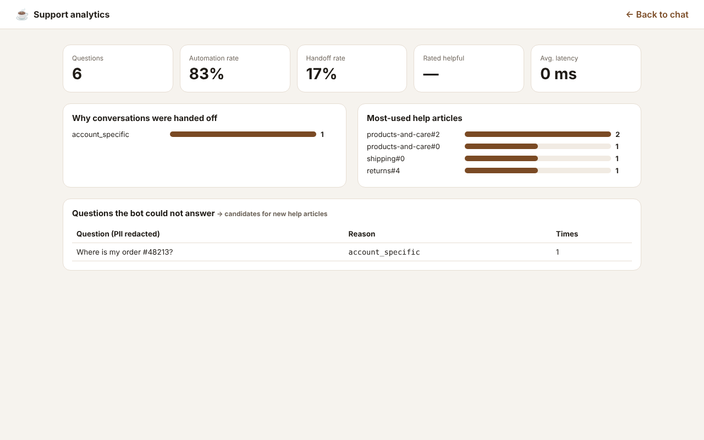

# RAG Support Assistant — grounded answers, cited sources, human handoff

> A customer-support assistant that answers **only** from a store's help-center
> articles, cites where each answer came from, and hands the conversation to a
> person whenever the question is order-specific, risky, or not covered.

    



**Live demo:** _deploy with `render.yaml` and add the link here_ · **Loom:** _add link_

---

## The problem

Support teams answer the same 30 questions hundreds of times a month. Generic
chatbots make things worse: they invent policies ("sure, 60-day returns!"),
can't say where an answer came from, and try to handle angry or order-specific
customers they have no data for.

## The solution



### Design decisions

| Decision | Why |
|---|---|
| **BM25 instead of embeddings** | For a few hundred help sections it is free, instant, deterministic and explainable. The `Retriever` class can be swapped for embeddings + pgvector when the corpus grows. |
| **Two-layer handoff** | Rules catch what retrieval can't judge (safety, legal, "where is my order #…"); retrieval confidence catches unknown topics; the model can still refuse with `[[HANDOFF]]`. |
| **Citations are required** | Every answer shows which article section it used, so agents can audit and customers can trust it. |
| **Works without an API key** | Extractive mode returns the best-matching sentences — useful for demos, CI and as a fallback when the API is down. |
| **Measured, not vibes** | `eval/` holds 32 labelled questions; CI prints retrieval and handoff metrics on every push. |
| **Privacy** | Emails, phone and card numbers are redacted before anything is stored. |

## Results (offline evaluation)

`python -m eval.run_eval` on 32 labelled questions (26 answerable, 6 that must be escalated):

| Metric | Score |
|---|---|
| Retrieval hit@1 | **96.2%** |
| Retrieval hit@3 | **100%** |
| Mean reciprocal rank | **0.974** |
| Correct answer-vs-handoff decision | **100%** |

The eval set is small and written by the author — it is a regression guard, not
a benchmark. Add real customer questions to `eval/questions.jsonl` before
trusting it for a client.

## Analytics for the support lead

`/admin` shows automation rate, handoff reasons, most-used articles and — most
useful — **the questions the bot could not answer**, which is the to-do list
for new help-center articles.



## Run it

```bash
git clone https://github.com/YOUR_USERNAME/rag-support-assistant.git
cd rag-support-assistant
python -m venv .venv && source .venv/bin/activate
pip install -r requirements.txt
cp .env.example .env            # optional: add ANTHROPIC_API_KEY for generative answers
uvicorn app.main:app --reload   # http://localhost:8000  and  /admin
pytest -q                       # 12 tests
python -m eval.run_eval         # quality report
```

Docker: `docker build -t rag-support . && docker run -p 8000:8000 --env-file .env rag-support`

## API

| Method | Path | Body / result |
|---|---|---|
| `POST` | `/api/chat` | `{message, session_id?, history?}` → `{answer, sources[], handoff, handoff_reason, confidence, mode, interaction_id}` |
| `POST` | `/api/feedback` | `{interaction_id, helpful}` |
| `GET` | `/api/analytics` | automation rate, handoff reasons, top sources, unanswered questions |
| `GET` | `/health` | mode (`claude` / `extractive`) and number of indexed sections |

## Use it for another business

1. Replace the files in `knowledge_base/` with the client's help articles (one `#` title, `##` per topic).
2. Update `STORE_NAME` in `.env` and the escalation patterns in `app/guardrails.py`.
3. Write 20–50 real questions into `eval/questions.jsonl` and tune `MIN_SCORE` / `MIN_COVERAGE` until the metrics are good.
4. Embed the chat on their site, or connect `/api/chat` to WhatsApp, Intercom or Zendesk.

## Project structure

```
app/
  main.py         FastAPI routes + orchestration
  retriever.py    markdown chunking, stemming, synonyms, BM25, coverage
  guardrails.py   escalation rules, confidence, PII redaction
  llm.py          Claude prompt, extractive fallback, citation parsing
  store.py        SQLite log + analytics queries
knowledge_base/   7 help-center articles for the fictional store
eval/             labelled questions + metrics script
static/           chat UI and analytics page (no build step)
tests/            API, guardrail, Claude-path (mocked) and quality tests
```

*Brewline Coffee Supply is a fictional company created for this demo.*

## License

MIT — see [LICENSE](LICENSE).

---

Built by **Nuzul Nur Robbulizzat** · AI integration & business analytics ·
[LinkedIn](https://linkedin.com/in/nuzulnurri)
